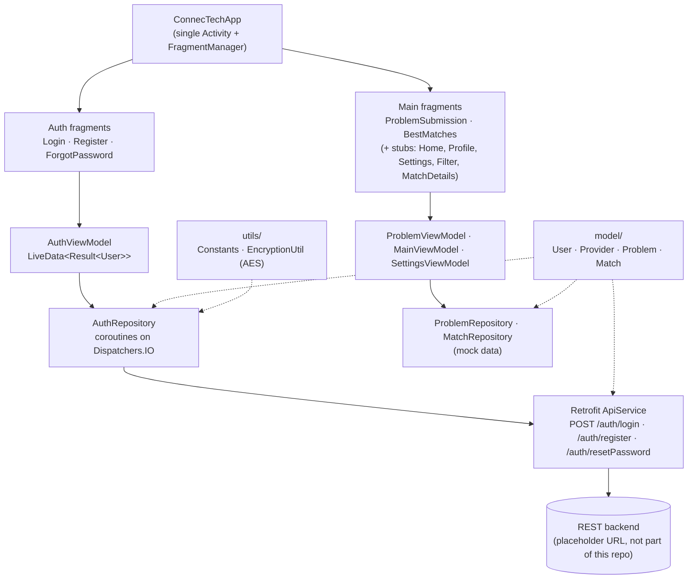

# ConnecTech

**An Android app concept for B2B matchmaking. Businesses post a technology problem, and the app matches them with tech service providers who have the right expertise.**

Team project for **CS 407 at the University of Wisconsin–Madison** (Fall 2024). This is a fork of the team repository [`sahilmehtx/ConnecTech`](https://github.com/sahilmehtx/ConnecTech).
<!-- TODO: add the full course title if you want it (e.g. "CS 407: <title>"), confirm the semester, and whether the project went past this milestone in the upstream repo. -->

---

## The problem

Small and mid-sized businesses often know *what* they need (a mobile app, a cloud migration, help with cybersecurity) but not *who* can do it. Tech service providers, for their part, spend heavily on marketing to find clients that fit their skills. ConnecTech's idea is to have a business describe its problem in a structured way and then match it to providers by expertise, availability, and rating.

## What we built

This repository is the project at its **Milestone 1** stage (November 2024). It is an Android app skeleton in Kotlin with:

- an MVVM layering (Fragments → ViewModels → Repositories → network/models)
- authentication screens (login, register, forgot password) wired to a Retrofit REST client
- problem submission and "best matches" screens with a RecyclerView adapter
- shared domain models and utilities (users, providers, problems, matches, constants, encryption)

The matching logic and data are **mocked** at this stage: repositories return hard-coded project and partner lists. The Retrofit client points at a placeholder base URL (`https://api.connectech.com/`). No backend is included in this repo.

## Architecture

The intended design at this milestone:



## Key features (as implemented)

- **Auth flow UI:** login, registration, and password-reset fragments with input validation and Toast feedback, using View/Data Binding.
- **Networking layer:** Retrofit + Gson `ApiService` with typed request models (`LoginRequest`, `RegisterRequest`, `ResetPasswordRequest`), and repository methods that wrap calls in Kotlin `Result` on `Dispatchers.IO`.
- **Problem submission:** a form with a category dropdown that hands off to the ViewModel layer.
- **Best matches list:** a `ListAdapter` + `DiffUtil` RecyclerView for showing matched providers.
- **Domain models:** typed Kotlin data classes for `User`, `Provider` (expertise list, rating, availability), `Problem` (category, status, ISO-8601 timestamp), and `Match` (provider ↔ problem with a score).
- **Utilities:** centralized constants (API base URL, timeout, error messages, SharedPreferences keys) and an AES-256 encrypt/decrypt helper.

## Tech stack

Kotlin · Android SDK (min 24, target/compile 35) · AndroidX Fragments, ViewModel, LiveData · View/Data Binding · Retrofit 2 + Gson · Kotlin Coroutines · Gradle (Kotlin DSL, AGP 8.6, Gradle 8.7)

## Project status

This snapshot is a **work-in-progress milestone and does not compile as-is**. Pieces written in parallel by different team members were merged before being integrated:

- `repository/AuthRepository.kt` contains an unresolved merge-conflict marker (`=======`) between two versions of `AuthRepository`.
- Some files declare `package com.connectech.app...` while others import from `com.cs407.connectech...`.
- `BestMatchesFragment` and `ProblemSubmissionFragment` call ViewModel members that don't exist yet (`bestMatches`, `fetchBestMatches()`, `submitProblem()`), and `MatchAdapter` reads `Match` fields (`name`, `rating`) that the `Match` model doesn't define.

<!-- TODO: either (a) fix these build blockers (resolve the AuthRepository conflict, unify packages to com.cs407.connectech.*, add the missing ViewModel members, align MatchAdapter with the Match/Provider models) and replace this section with a screenshot of the running app, or (b) leave this section as-is so the repo stays honest. -->

## My contributions

I owned the **shared domain model and utility layer** (commit [`93f145d`](../../commit/93f145d), about 150 lines across 6 files), which the other sub-teams built on:

- `model/User.kt`, `model/Provider.kt`, `model/Problem.kt`, `model/Match.kt`: replaced empty class stubs with typed Kotlin data classes. Each file has a header documenting every field and explaining how the frontend, backend, and matching sub-teams should use or extend it. `User` is the response type used by `ApiService`, `AuthRepository`, and `AuthViewModel`.
- `utils/Constants.kt`: a central place for the API base URL, request timeout, user-facing error messages, and SharedPreferences keys.
- `utils/EncryptionUtil.kt`: AES-256 key generation, encrypt/decrypt to Base64, and key reconstruction from bytes.
- Merged team pull requests #9 and #10 (integrating `main` with the `Harsh` branch).

<!-- TODO: if you did work outside this repo (design, presentations, testing, later milestones), add it here. Only list what you can point to. -->
<!-- TODO (optional): EncryptionUtil uses Cipher.getInstance("AES"), which defaults to ECB mode. If you fix the build, consider switching to "AES/GCM/NoPadding" with a random IV. Mentioning it as a lesson learned is also a good signal. -->

## Team

| Member | Main areas (from commit history) |
|---|---|
| [@sahilmehtx](https://github.com/sahilmehtx) | Project setup and starter code, authentication UI (login/register/forgot password + layouts), `AuthViewModel`, Retrofit networking layer, original README |
| [@tmodi3](https://github.com/tmodi3) | Milestone 1 screens: problem submission, best matches, `MatchAdapter`, and their layouts |
| [@sgupta285](https://github.com/sgupta285) | Starter code, ViewModels (`Main`, `Problem`, `Settings`), repositories (`Auth`, `Match`, `Problem`) with mock data |
| [@Harsh-Sahay009](https://github.com/Harsh-Sahay009) | Domain models (`User`, `Provider`, `Problem`, `Match`), `Constants`, `EncryptionUtil` |

<!-- TODO: add teammates' full names if they're happy to be named. -->

## Running locally

Requirements: Android Studio (with Android SDK 35) and JDK 17.

```bash
git clone https://github.com/Harsh-Sahay009/ConnecTech.git   # TODO: update if the repo name changes
cd ConnecTech
./gradlew assembleDebug
```

Or open the project in Android Studio and run the `app` configuration on an emulator (API 24+).

> The build currently fails because of the issues listed under **Project status**.

## Screenshots

<!-- TODO: no images in the repo. Once the app builds, add screenshots of the login screen, problem submission, and best matches. -->
